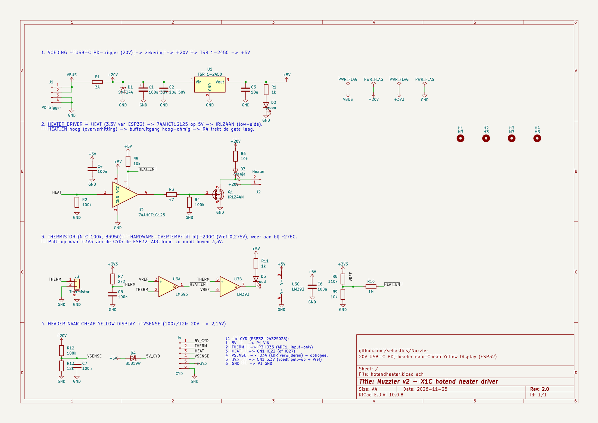

# Nuzzler
A hotend heater for Bambu Lab X1C hotends: heat a nozzle to a controlled temperature so it can be cleaned (cold pull, purge, needle).

> **v2 is untested.** The design passes ERC and DRC (including schematic parity), but no board has been built yet.

## v2: power/driver board for a Cheap Yellow Display

v1 was an Arduino Nano with a display module on a 12V USB-C PD trigger. v2 drops the Nano and display. It is now a
power and heater-driver board with a 6-pin header to a **Cheap Yellow Display** (ESP32-2432S028), which will do the UI and control.

What changed and why:

| | v1 | v2 |
|---|---|---|
| Supply | 12V PD (12 W at 12 Ω) | **20V PD (≈33 W, 1.7 A)** |
| 5V rail | Nano regulator (fed from VIN) | **TSR 1-2450 buck** (6.5–36 V in) |
| MOSFET | IRF540N (not logic level, driven at ~4.5 V) | **IRLZ44N**, driven at 5 V through a **74AHCT1G125** buffer, so a 3.3 V ESP32 pin can switch it fully |
| Thermistor pull-up | 100k to 5V (≈5–10 °C per ADC step at 220 °C) | **2k2 to the CYD 3.3V**: good resolution from 90 to 290 °C and never above 3.3 V on the ESP32 ADC |
| Protection | none | 3A fuse, SMF24A TVS, 100 µF bulk, **hardware over-temperature cutoff** (LM393, trips at ~290 °C, re-enables at ~276 °C) |
| Extras | | Supply-voltage sense (VSENSE), LEDs for 5V / heater on / over-temperature |

### X1C hotend facts (used for the design)
- Ceramic heater: 48 W, ~12 Ω cold, rated for 300 °C. At 24 V in the printer that gives 48 W; at 20 V here ≈33 W.
- Thermistor: NTC, 50–100 kΩ at room temperature (almost certainly 100k, B≈3950).
- Cold pull: heat to ~220 °C (PLA), then let it cool to ~90–100 °C and pull.

### Header J4 → CYD

| J4 | Signal | CYD |
|---|---|---|
| 1 | 5V (through Schottky D4) | P1 VIN |
| 2 | NTC (thermistor, 0–3.3 V) | P3 IO35 (ADC1, input only) |
| 3 | HTR (heater enable / PWM, 3.3 V logic) | CN1 IO22 (or IO27) |
| 4 | VS (supply voltage /9.33: 20 V → 2.14 V) | IO34 after removing the LDR (optional) |
| 5 | 3V3 (from the CYD: thermistor pull-up and comparator reference) | CN1 3.3V |
| 6 | GND | P1 GND |

The heater can't turn on without the CYD: HTR has a pulldown, and without 3V3 the thermistor reads "cold" but HTR stays low.

### Firmware notes
- Thermistor: `R_ntc = 2200 * V / (3.3 - V)`, then Beta or Steinhart–Hart. Use the ESP32 ADC calibration (11 dB attenuation).
- At 20 V the hotend heats quickly and overshoots without a fan: use PID, a soft maximum of ~280 °C (heater rating is 300 °C) and thermal-runaway detection (no temperature rise within X s while heating → off).
- PWM: anything up to ~1 kHz is fine; a slow PWM (e.g. 10 Hz) also works for a heater.
- If VS is used: refuse to heat unless the PD trigger actually delivers ~20 V.
- The hardware cutoff is a backstop only and does not replace firmware limits.

### Bill of materials

| Ref | Qty | Value | Footprint | Notes |
|---|---|---|---|---|
| C1 | 1 | 100µF 35V | CP_Elec_6.3x7.7 | electrolytic |
| C2 | 1 | 10µF 50V | 1206 | X7R |
| C3 | 1 | 10µF 16V | 0805 | |
| C4, C5, C6, C7 | 4 | 100nF | 0805 | |
| D1 | 1 | SMF24A | SOD-123FL | TVS, unidirectional |
| D2, D3, D5 | 3 | LED green / orange / red | 0805 | 5V / heater on / over-temperature |
| D4 | 1 | B5819W | SOD-123 | Schottky |
| F1 | 1 | 3A fast, ≥32V | 1206 | |
| J1 | 1 | 1x4 pin header | 2.54 mm | for the USB-C PD trigger module (set to 20V); check the module pinout: pins 1–2 V+, 3–4 GND |
| J2 | 1 | JST XH 2-pin horizontal | S2B-XH-A | heater |
| J3 | 1 | JST GH 2-pin horizontal | SM02B-GHS-TB | thermistor |
| J4 | 1 | 1x6 pin header | 2.54 mm | to CYD |
| Q1 | 1 | IRLZ44N | TO-220 | |
| R1, R11 | 2 | 1k | 0805 | |
| R2, R4, R12 | 3 | 100k | 0805 | |
| R3 | 1 | 47Ω | 0805 | |
| R5, R6, R9 | 3 | 10k | 0805 | |
| R7 | 1 | 2k2 | 0805 | thermistor pull-up |
| R8 | 1 | 110k | 0805 | sets the cutoff temperature |
| R10 | 1 | 1M | 0805 | hysteresis |
| R13 | 1 | 12k | 0805 | |
| U1 | 1 | Traco TSR 1-2450 | SIP-3 | or a pin-compatible 7805 buck module, e.g. Mornsun K7805-1000R3 |
| U2 | 1 | 74AHCT1G125 | SOT-23-5 | |
| U3 | 1 | LM393 | SOIC-8 | |

Board: 56 × 46 mm, 2 layers, 4× M3. Gerbers and drill files: [`grbrs/nuzzler-v2-gerbers.zip`](grbrs/nuzzler-v2-gerbers.zip).

