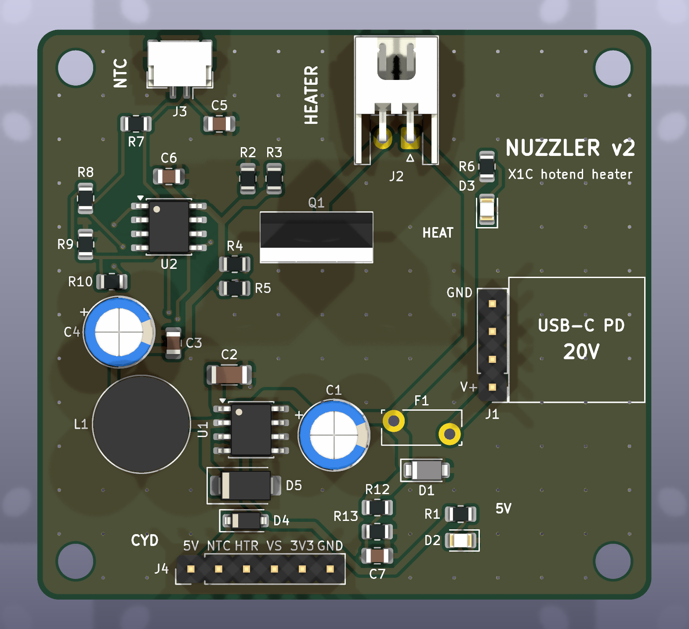

# Nuzzler
A hotend heater for Bambu Lab X1C hotends: heat a nozzle to a controlled temperature so it can be cleaned (cold pull, purge, needle).

> **v2 is untested.** The design passes ERC and DRC (including schematic parity), but no board has been built yet.

## v2: power/driver board for a Cheap Yellow Display

v1 was an Arduino Nano with a display module on a 12V USB-C PD trigger. v2 drops the Nano and display. It is now a
power and heater-driver board with a 6-pin header to a **Cheap Yellow Display** (ESP32-2432S028), which will do the UI and control.

What changed and why:

| | v1 | v2 |
|---|---|---|
| Supply | 12V PD (12 W at 12 Ω) | **20V PD (≈33 W, 1.7 A)** |
| 5V rail | Nano regulator (fed from VIN) | **XL1509-5.0 buck** (4.5–40 V in, JLC basic part) |
| MOSFET | IRF540N (not logic level, driven at ~4.5 V) | **IRLZ44N**, gate driven to 5 V by an LM393 comparator (HEAT > 2.5 V), so a 3.3 V ESP32 pin can switch it fully |
| Thermistor pull-up | 100k to 5V (≈5–10 °C per ADC step at 220 °C) | **2k2 to the CYD 3.3V**: good resolution from 90 to 290 °C and never above 3.3 V on the ESP32 ADC |
| Protection | none | 2.5A PTC, SMF24A TVS, 100 µF bulk, **hardware over-temperature cutoff** (other half of the LM393, trips at ~281 °C, re-enables at ~270 °C; wired-AND on the gate) |
| Extras | | Supply-voltage sense (VSENSE), LEDs for 5V / heater on |

### X1C hotend facts (used for the design)
- Ceramic heater: 48 W, ~12 Ω cold, rated for 300 °C. At 24 V in the printer that gives 48 W; at 20 V here ≈33 W.
- Thermistor: NTC, 50–100 kΩ at room temperature (almost certainly 100k, B≈3950).
- Cold pull: heat to ~220 °C (PLA), then let it cool to ~90–100 °C and pull.

### Header J4 → CYD

| J4 | Signal | CYD |
|---|---|---|
| 1 | 5V (through Schottky D4) | P1 VIN |
| 2 | NTC (thermistor, 0–3.3 V) | P3 IO35 (ADC1, input only) |
| 3 | HTR (heater enable / PWM, 3.3 V logic) | CN1 IO22 (or IO27) |
| 4 | VS (supply voltage /9.33: 20 V → 2.14 V) | IO34 after removing the LDR (optional) |
| 5 | 3V3 (from the CYD: thermistor pull-up and comparator reference) | CN1 3.3V |
| 6 | GND | P1 GND |

The heater can't turn on without the CYD: HTR has a pulldown, and without 3V3 the thermistor reads "cold" but HTR stays low.

### Firmware notes
- Thermistor: `R_ntc = 2200 * V / (3.3 - V)`, then Beta or Steinhart–Hart. Use the ESP32 ADC calibration (11 dB attenuation).
- At 20 V the hotend heats quickly and overshoots without a fan: use PID, a soft maximum of ~260 °C (the hardware cutoff is at ~281 °C, the heater rating is 300 °C) and thermal-runaway detection (no temperature rise within X s while heating → off).
- PWM: anything up to ~1 kHz is fine; a slow PWM (e.g. 10 Hz) also works for a heater.
- If VS is used: refuse to heat unless the PD trigger actually delivers ~20 V.
- The hardware cutoff is a backstop only and does not replace firmware limits.

### Manufacturing at JLCPCB (Economic PCBA)

All SMD parts on the top side are **JLC Basic or Preferred Extended** parts, so there are **no $3.07 feeder-loading fees**.
Files are in [`jlc/`](jlc): Gerbers, `nuzzler-v2-BOM-JLC.csv` and `nuzzler-v2-CPL-JLC.csv` (top side, positions from KiCad).
Check the part rotations in JLC's placement preview (especially U1/U2 SOIC-8 and the diodes D1, D4, D5 and LEDs D2, D3).

JLC places (24 parts, 16 unique, 60 joints per board):

| Ref | Qty | Value | Footprint | LCSC | Type |
|---|---|---|---|---|---|
| U1 | 1 | XL1509-5.0E1 | SOIC-8 | C61063 | Basic |
| U2 | 1 | LM393DR2G | SOIC-8 | C7955 | Basic |
| D1 | 1 | SMF24A (TVS) | SOD-123FL | C19077514 | Preferred |
| D4 | 1 | B5819W | SOD-123 | C8598 | Basic |
| D5 | 1 | SS34 | SMA | C8678 | Basic |
| D2 | 1 | LED green | 0805 | C2297 | Basic |
| D3 | 1 | LED yellow | 0805 | C2296 | Basic |
| C2 | 1 | 10µF 50V | 1206 | C13585 | Basic |
| C3 | 1 | 10µF 25V | 0805 | C15850 | Basic |
| C5, C6, C7 | 3 | 100nF 50V | 0805 | C49678 | Basic |
| R1, R3 | 2 | 1k | 0805 | C17513 | Basic |
| R7 | 1 | 2k2 | 0805 | C17520 | Basic |
| R4, R5, R6, R9 | 4 | 10k | 0805 | C17414 | Basic |
| R13 | 1 | 12k | 0805 | C17444 | Basic |
| R2, R8, R12 | 3 | 100k | 0805 | C149504 | Basic |
| R10 | 1 | 1M | 0805 | C17514 | Basic |

Hand-soldered (through-hole, plus the small JST-GH, which is not in JLC's cheap library):

| Ref | Qty | Part | Notes |
|---|---|---|---|
| Q1 | 1 | IRLZ44N | TO-220 |
| L1 | 1 | 68µH ≥1A radial, 5 mm pitch, Ø≤8.7 mm | e.g. Fastron 07HCP-680K, Bourns RLB0914-680KL |
| C1 | 1 | 100µF 35V radial Ø6.3 mm, 2.5 mm pitch | |
| C4 | 1 | 220µF 16V radial Ø6.3 mm, 2.5 mm pitch | buck output |
| F1 | 1 | PTC Ihold 2.5A, ≥30V, radial 5.1 mm | e.g. Bourns MF-R250, Littelfuse 30R250UU |
| J1 | 1 | 1x4 pin header 2.54 mm | + USB-C PD trigger module set to 20V; check the module pinout: pins 1–2 V+, 3–4 GND |
| J2 | 1 | JST XH 2-pin horizontal (S2B-XH-A) | heater |
| J3 | 1 | JST GH 2-pin SMD horizontal (SM02B-GHS-TB) | thermistor |
| J4 | 1 | 1x6 pin header 2.54 mm | to CYD |

Board: 56 × 52 mm, 2 layers, 4× M3, all SMD on top. Gerbers and drill files: [`grbrs/nuzzler-v2-gerbers.zip`](grbrs/nuzzler-v2-gerbers.zip).

